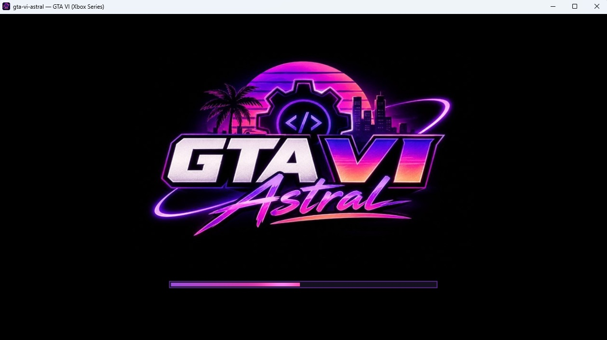

# gta-vi-astral (ASTRAL)

Système modulaire en **Go** pour l'analyse, la recompilation de shaders et l'exécution native sur PC de **Grand Theft Auto VI (Xbox Series X|S, v1.0.2.1)** à partir de votre propre copie locale du jeu.

> **Règle #1 (Clean-Room)** : ce dépôt ne contient **aucun fichier du jeu, aucune clé, aucun exécutable ni aucun mécanisme de déchiffrement**. Toutes les données dérivées (caches, shaders traduits, sauvegardes, overlay, logs) sont strictement gardées **en dehors du dépôt** grâce au garde-fou `.astral-root` (`pkg/core/policy.go`).

> [!WARNING]
> **Projet expérimental en cours de développement — NON JOUABLE actuellement.**
> Le moteur démarre, charge toutes ses archives (`.rpf` + TTDB + licences), connecte l'utilisateur hors-ligne (`XUser` + `XGameSave`) et tourne en boucle continue **780+ frames `PresentX` sur 45 s (0 crash, 0 `WARN`)** avec recompilation live de ses shaders RDNA2 sur GPU Windows, mais le rendu 3D complet et l'audio ne sont **pas encore fonctionnels**.

## Avancement global : ~46 %

```text
Progression globale : [█████████░░░░░░░░░░░] 46 %
```

- **Boot natif continu + `XUser` + `XGameSave` + `XAsyncRun` + `XStore` + DirectStorage (`story000.rpf`)** : ✅ Opérationnel (`90 %`)
- **Interfaces 2D / menus de configuration (`ASTRALPLAYER (A)` -> `EXPÉRIENCE DE NAVIGATION` -> `TERMINER LA CONFIGURATION ?`)** : 🔄 En cours (`~75 %` — navigation et textes fonctionnels, fond de panneau UI encore imparfait)
- **Audio console (`xapu` Opus + `AcpHal` XMA2 vers WASAPI)** : 🔄 En cours (`~35 %` — décodage Opus 48 kHz pur Go opérationnel pour les sons UI/clics + pacing 60 Hz ; décodage XMA2 et audio d'intro à compléter)
- **Rendu 3D temps réel & monde ouvert jouable (shaders 3D bindless, G-Buffer, Depth-Stencil, BCPack, ray tracing)** : ⏳ Début (`~15 %`)

| Sous-système | Avancement | État actuel | Reste à faire |
| :--- | :---: | :--- | :--- |
| **Chargeur PE / Mémoire / CPU x64** | `90 %` | Mappage natif, `DllMain` des DLL du titre, 53 246 patchs TLS, VEH + émulation AMD Zen 2 (`CLZERO`, `MONITORX`, `MWAITX`, `RDPRU`, `CLWB`, SSE4a `INSERTQ`/`EXTRQ`), pools physiques 64 KiB (`xmem` 6,2 Go) + `xmemMapAlias` + `xmemWritePhysical`. | Cas limites CPU/mémoire en monde ouvert. |
| **Stockage & Streaming (`VirtualFS` / `DirectStorage`)** | `75 %` | 20+ `.rpf` (jusqu'à `story000.rpf` / `story000_script.rpf`) et TTDB `.ttpf` ouverts ; 23 000+ requêtes `ReadAt` + `zlib`, `EnqueueSignal`, et `PAGE_DESTINATION` (pages physiques 64 KiB). | Décompression **BCPack** (textures 3D BC1–BC7) et exécution **asynchrone** multi-thread (pour ne plus bloquer l'audio). |
| **OS Console / HLE (`xgameruntime`, `GameInput`)** | `88 %` | `xasync`/`XTaskQueue` (ports partagés composites), `xuser` (`AstralPlayer`), `xgamesave` 30 slots sur disque, `xstore`/`xgameui`/`xnetworking` hors-ligne, `OEM\ConsoleMode`, `GameInput` complet (DualSense PS5 / XInput / clavier). | APIs secondaires rencontrées en jeu. |
| **Audio (`AcpHal` / `xapu` / `chad`)** | `35 %` | Allocation/mapping APU (`ApuMapVirtualAddress` corrigé), canal `IAcpHal`, décodeur **Opus 48 kHz pur Go** actif (`xapu.dll`, `ApuResult` 80 octets, sons de clics UI audibles), pacing 60 Hz (`timeBeginPeriod(1)`). | Décodage **XMA2** (`AcpHal` SHAPE 350 contextes), correction complète de l'audio global d'intro. |
| **Recompilateur Shaders RDNA2 (`pkg/shader`)** | `30 %` | Extraction `DXBC->XDAT->XBCH->FSSM`, décodeur GFX10 partiel, recompilation live HLSL SM 5.0 suffisante pour l'UI 2D Scaleform et quelques Compute Shaders simples. | Masque `EXEC` par lane, descripteurs **bindless**, `LDS`/`FLAT`, émulation wave64, **DXIL SM 6.6**, Mesh/Amplification Shaders (indispensables pour la 3D). |
| **Pont GPU Hôte D3D12 (`pkg/gpu` + `d3d12x`)** | `35 %` | Fenêtre Win32 unique 1280×720, `PresentX` à 30 fps, rejeu de passes 2D/UI, RenderTargets offscreen, rafraîchissement dynamique de l'atlas de police, détuilage RDNA2, Compute root bindings de base. | **G-Buffer / MRT**, **Depth-Stencil (`DSV`)**, tas de descripteurs bindless, `ExecuteIndirect`, synchronisation inter-files (`Wait64BitValueX`), rendu 3D complet. |

## Captures d'avancement

Les captures d'écran illustrant les jalons techniques sont stockées dans [`docs/screenshots/`](docs/screenshots/).

### Écran de chargement / préchargeur (splash D3D12 + barre néon temps réel)



*Écran de préchargement natif dans la fenêtre `gta-vi-astral` (icône synthwave dédiée + barre de progression néon pilotée en temps réel par DirectStorage, `XUser` et `XGameSave`).*

### Profil `ASTRALPLAYER (A)` actif & sélectionnable à la manette


*Profil hors-ligne `ASTRALPLAYER (A)` affiché en temps réel suite à la résolution complète de `XUSER_GAMERTAG_IID`, `XUSER_DEVICE` et de la vtable 30 slots `XGameSave`.*

## Pourquoi ASTRAL ?

**gta-vi-astral** synthétise en Go les meilleures idées architecturales de deux projets de référence :

- **De VIctory** : l'architecture ultra-modulaire par responsabilités (`pkg/*` inspiré de `crates/*`), le garde-fou anti-fuite d'assets, la préparation PE32+ en « DLL passive », la résolution d'imports en 4 priorités, le cache atomique adressé par contenu, la couche HLE hors-ligne (GDK, XMem, DirectStorage, Audio XMA2/Opus) et le backend D3D12 hôte (DXIL SM 6.6).
- **De Leonida** : l'analyse exhaustive des archives et shaders RDNA2 (26 503 shaders), le décodage et l'émulation **wave64** pour les GPU 32-wide (NVIDIA/Intel), l'overlay copy-on-write sur `GAME:`, les contrats ABI mesurés sur `d3d12_xs.dll` et le backend portable Vulkan + constructeur BVH4 XDXR.

## Architecture des packages

```text
gta-vi-astral/
├── cmd/astral/       # Lanceur graphique Windows natif (GUI) + interface CLI unifiée
├── pkg/
│   ├── core/         # Configuration TOML/env, garde-fou anti-fuite (.astral-root), logs slog
│   ├── pe/           # Analyseur PE32+ x86-64 (sections, entropie, imports/exports, TLS, .pdata, CodeView)
│   ├── formats/      # SGD5, RPF9 (en-tête), layouts textures RDNA2 GFX10.3, AWC audio, JOAAT32
│   ├── shader/       # DXBC -> XDAT -> XBCH -> FSSM, décodeur RDNA2/GFX10, CFG/IR, cible DXIL ou SPIR-V
│   ├── pipeline/     # Cache atomique SHA-256 hors dépôt + orchestrateur parallèle par goroutines
│   ├── gpu/          # Contrats ABI Xbox D3D12.X + abstraction double backend (D3D12 / Vulkan)
│   ├── hle/          # Registre de shims console, HostPolicy, VirtualFS (overlay COW), XMem
│   ├── loader/       # Résolution d'imports (4 niveaux), recensement (census), préparation passive-DLL, crash log
│   └── game/         # Identité spécifique GTA VI Xbox Series 1.0.2.1 et lecture MicrosoftGame.Config
└── docs/             # Documentation technique complète en français
```

## Documentation

Toute la documentation technique en français est disponible dans [`docs/README.md`](docs/README.md).

---

## Vision du projet

### Présentation

**GTA VI Astral** (développé par Archivist-Atlas) est un projet indépendant de recherche et de développement logiciel consacré à l'étude des techniques de recompilation, de compatibilité multiplateforme et d'intégration de systèmes d'intelligence artificielle dans les environnements vidéoludiques.

L'objectif à long terme est d'explorer les possibilités offertes par la recompilation logicielle afin d'étudier l'intégration de fonctionnalités indépendantes qui ne sont pas nécessairement prévues dans l'environnement d'exécution d'origine.

GTA VI constitue une cible de recherche envisagée pour expérimenter ces technologies.

### Objectif principal : des personnages non joueurs pilotés par IA

L'une des ambitions principales du projet est d'étudier le développement d'un système indépendant d'intelligence artificielle destiné à enrichir les interactions entre les joueurs et les personnages non joueurs (PNJ).

Les systèmes traditionnels reposent souvent sur des dialogues prédéfinis, des arbres de conversation et des comportements scriptés. **GTA VI Astral** souhaite explorer des approches permettant de rendre ces interactions plus dynamiques, contextuelles et cohérentes.

Les axes de recherche envisagés comprennent :

- **Conversations dynamiques** : permettre aux PNJ de générer des réponses adaptées au contexte des échanges avec le joueur.
- **Mémoire persistante** : étudier la possibilité pour les PNJ de conserver des informations pertinentes issues de leurs interactions précédentes.
- **Personnalités individuelles** : développer des profils comportementaux distincts, avec des préférences, des habitudes et des styles de communication propres à chaque personnage.
- **Réactions contextuelles** : permettre aux personnages de prendre en compte les événements environnants et les situations auxquelles ils sont confrontés.
- **Comportements adaptatifs** : explorer des systèmes dans lesquels les réactions et les interactions évoluent en fonction des expériences simulées des personnages.
- **Interactions sociales** : étudier la possibilité de faire évoluer les relations entre les PNJ en fonction des événements et des informations qu'ils partagent.

L'objectif n'est pas simplement de remplacer les dialogues existants par un modèle conversationnel, mais d'étudier une architecture capable de combiner mémoire, personnalité, contexte et comportement.

### Recompilation et compatibilité PC

La recherche sur la recompilation constitue un axe technique du projet. Elle vise à étudier les mécanismes nécessaires à l'analyse de logiciels compilés, à la traduction de code machine et à la génération de code adapté à différents environnements d'exécution.

Les travaux envisagés comprennent notamment :

- L'analyse des structures des exécutables.
- L'étude des architectures processeur et des instructions machine.
- La création de représentations intermédiaires du code.
- L'exploration de techniques de traduction et de génération de code natif.
- L'étude des interfaces entre les logiciels et les systèmes d'exploitation.
- Le développement de composants indépendants de compatibilité et d'interopérabilité.

Cette recherche doit également permettre d'étudier les possibilités d'intégration d'un moteur d'intelligence artificielle indépendant avec un environnement logiciel compatible. La recompilation et l'intégration IA constituent deux axes techniques distincts, dont les interfaces et les contraintes devront être étudiées et documentées.

### Architecture d'intelligence artificielle envisagée

L'architecture envisagée repose sur plusieurs composants indépendants :

- **Moteur conversationnel** : génération de dialogues adaptés au contexte.
- **Système de mémoire** : conservation des informations pertinentes relatives aux interactions.
- **Gestion des personnalités** : définition des caractéristiques et comportements propres à chaque PNJ.
- **Moteur décisionnel** : interprétation des situations et sélection de réactions cohérentes.
- **Couche d'intégration** : communication entre le moteur IA et un environnement logiciel compatible.

L'exécution de ces composants pourra être étudiée localement sur PC ou au moyen de services externes, selon les contraintes de performances, de confidentialité et d'architecture.

### Indépendance du développement

**GTA VI Astral** (maintenu par Archivist-Atlas) développe ses propres outils et composants logiciels. Le projet distingue clairement les technologies développées indépendamment des logiciels tiers étudiés dans le cadre de ses recherches.

Il n'a pas pour objectif de distribuer le code source propriétaire, les exécutables, les ressources graphiques, les fichiers audio ou les autres contenus protégés appartenant aux éditeurs des logiciels concernés. Toute utilisation de fichiers tiers reste soumise aux droits et autorisations applicables.

### Cadre juridique

Les travaux de recherche sont conduits dans le respect des législations applicables en matière de propriété intellectuelle, de logiciels et de protection des mesures techniques.

Les références juridiques et les précisions relatives aux activités envisagées sont présentées dans le fichier [`LEGAL.md`](LEGAL.md).

Le présent projet ne revendique aucune autorisation générale de décompilation, de reproduction ou de modification de logiciels propriétaires.

### Indépendance et absence d'affiliation

**GTA VI Astral** est un projet indépendant, non officiel et sans affiliation avec Rockstar Games, Rockstar North ou Take-Two Interactive.

Les noms de produits et marques éventuellement mentionnés sont utilisés uniquement à des fins descriptives et restent la propriété de leurs détenteurs respectifs.
